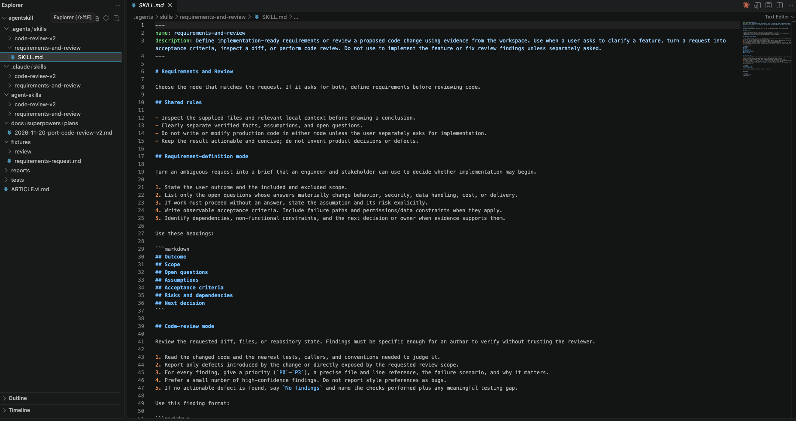
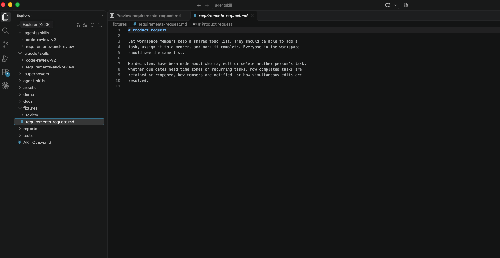
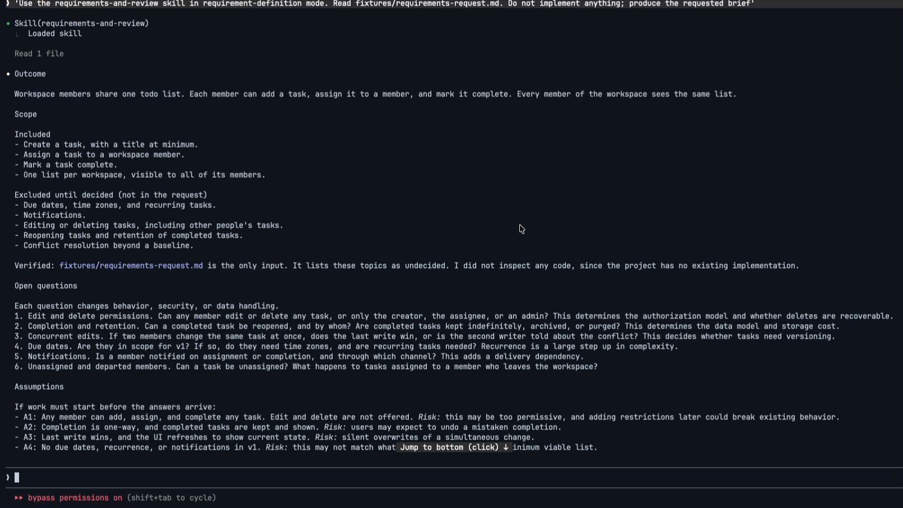
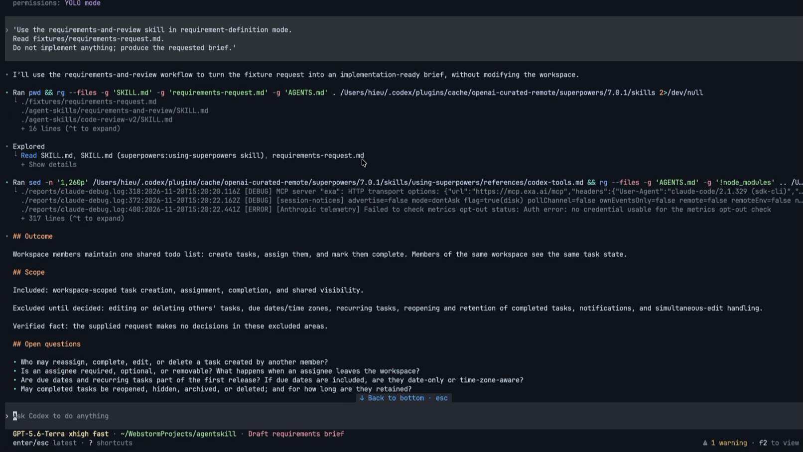
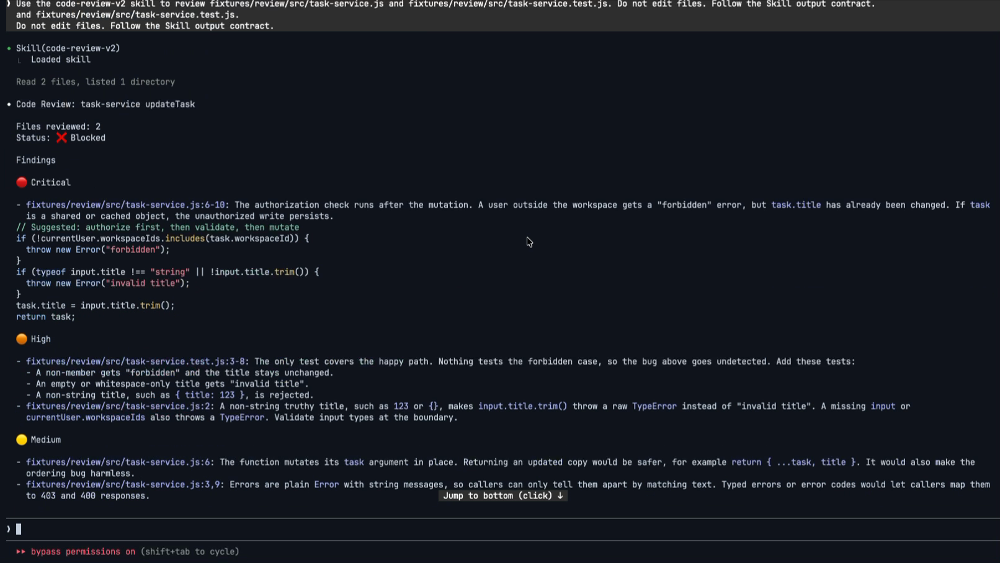

# Một `SKILL.md`, hai coding agent: Agent Skills có thật sự tái sử dụng được không?

Agent Skills đang đi theo một ý tưởng rất thực dụng: thay vì lặp lại prompt
cho những việc quen thuộc, ta đóng gói quy trình thành một thư mục có
`SKILL.md`, kèm tài liệu, script hay asset khi cần. Chuẩn Agent Skills yêu cầu
thư mục Skill có tối thiểu `SKILL.md`, YAML frontmatter và phần hướng dẫn bằng
Markdown; `name` và `description` là hai trường bắt buộc. [Đặc tả chính thức](https://agentskills.io/specification)
cũng khuyến nghị progressive disclosure: agent chỉ đọc metadata ban đầu, rồi
mới nạp hướng dẫn và tài nguyên khi Skill phù hợp.

Điều đáng chú ý là đây không còn là một định dạng độc quyền. Claude Code nói
rõ Skills của họ theo chuẩn mở Agent Skills, dù có thêm các extension riêng như
kiểm soát cách gọi Skill hay dynamic context. [Tài liệu Claude Code](https://code.claude.com/docs/en/skills)
Codex/ChatGPT cũng mô tả Skill là thư mục gồm instructions và resources cho
workflow lặp lại. [Tài liệu OpenAI](https://developers.openai.com/plugins/concepts/skills)
Và đây là một hướng liên nền tảng chứ không chỉ giữa hai hãng: GitHub Copilot
cũng hỗ trợ project skills ở `.github/skills`, `.claude/skills` và
`.agents/skills`. [GitHub Docs](https://docs.github.com/en/copilot/concepts/customizations/agent-skills)

Tôi đã kiểm chứng nhận định đó bằng một Skill thật, không chỉ chuyển đổi
frontmatter trên giấy.

Toàn bộ artifact, source code, fixture, transcript và media của bài có tại
[repository GitHub public](https://github.com/mhieupham1/portable-agent-skills-demo).

Bài viết trả lời ba câu hỏi cụ thể:

- Một `SKILL.md` chỉ dùng phần chuẩn có chạy được trên cả Claude Code và Codex không?
- Quy trình cho requirement definition và code review có tái sử dụng được không?
- Chuẩn hóa này hữu ích thế nào trong công việc hằng ngày, và giới hạn của nó là gì?

## Kết luận nhanh

**Có, trong phạm vi thử nghiệm này.** Cùng một `SKILL.md` dùng frontmatter
chuẩn đã được Claude Code và Codex thực thi cho hai tác vụ: requirement definition
và code review. Cả hai đạt 8/8 theo rubric đã công bố. Điều đó chứng minh quy
trình có thể tái sử dụng trên case nhỏ đã kiểm tra; nó không chứng minh hai model
có chất lượng, chi phí hay tốc độ tương đương.

## Thí nghiệm: một workflow, hai nhiệm vụ

Skill gốc là [file `SKILL.md` trên GitHub](https://github.com/mhieupham1/portable-agent-skills-demo/blob/main/agent-skills/requirements-and-review/SKILL.md).
Nó dùng **chỉ** hai trường chuẩn `name` và `description`, không dùng
frontmatter riêng của Claude Code hoặc Codex. Skill có hai mode:

- **Requirement definition**: tách outcome, scope, câu hỏi mở, giả định,
  acceptance criteria, rủi ro và quyết định kế tiếp.
- **Code review**: chỉ nêu lỗi có bằng chứng, bắt buộc priority, file:line,
  failure scenario và review coverage.



*Hình 1 — Phần dùng chung của `requirements-and-review`. Cùng workflow được đặt
tại các thư mục Skill của Codex, Claude Code và bản gốc; `SKILL.md` chỉ
dùng frontmatter chuẩn `name` và `description`, rồi định nghĩa hai mode
requirement definition và code review.*

Do vị trí cài đặt mỗi CLI khác nhau, cùng nội dung Skill được đặt ở
`.claude/skills/requirements-and-review/` cho Claude Code và
`.agents/skills/requirements-and-review/` cho Codex. Ba file có cùng SHA-256:
`f0ec6011fdcd0a160e3420902e0902fd4bcd44b56331e628874ea01251f1648e`.
Có thể đối chiếu trực tiếp [bản gốc](https://github.com/mhieupham1/portable-agent-skills-demo/blob/main/agent-skills/requirements-and-review/SKILL.md),
[bản Claude Code](https://github.com/mhieupham1/portable-agent-skills-demo/blob/main/.claude/skills/requirements-and-review/SKILL.md)
và [bản Codex](https://github.com/mhieupham1/portable-agent-skills-demo/blob/main/.agents/skills/requirements-and-review/SKILL.md).

Từ setup này có hai điểm cần phân biệt:

- **Phần dùng chung** là nội dung Skill: cùng frontmatter, hướng dẫn và quy ước
  cấu trúc đầu ra.
- **Phần riêng của từng CLI** chỉ là đường dẫn cài đặt.

```text
SKILL.md dùng chung
├── .claude/skills/requirements-and-review/  → Claude Code
└── .agents/skills/requirements-and-review/  → Codex
                         ↓
              cùng prompt + fixture + rubric
                         ↓
                  hai transcript để đối chiếu
```

## Tình huống demo: Shared Todo List

Repository kèm một web demo local: thành viên workspace tạo task, giao task,
đánh dấu hoàn thành và lọc `All / Active / Done`. Nó chỉ cung cấp bối cảnh sản
phẩm chung cho tình huống kiểm thử: Skill không tạo web này và web không được dùng để chấm
kết quả. Demo không có backend, login, persistence hay dữ liệu thật. [Xem source
demo trên GitHub](https://github.com/mhieupham1/portable-agent-skills-demo/tree/main/demo/shared-todo).


*Hình 2 — Shared Todo List chạy local. Ảnh cho thấy form tạo task, bộ lọc
`All / Active / Done`, task đã hoàn thành và số lượng task còn active.*

Tôi dùng cùng prompt tương ứng, cùng tình huống kiểm thử (fixture) và cùng
rubric (bảng tiêu chí chấm) cho cả hai agent. Bài requirement dùng [fixture Shared Todo List trên GitHub](https://github.com/mhieupham1/portable-agent-skills-demo/blob/main/fixtures/requirements-request.md)
trong cùng bối cảnh Shared Todo List: thành viên workspace tạo task, giao task
và đánh dấu hoàn thành. Quyền sửa/xóa task của người khác, deadline/timezone,
recurring task, retention/reopen, thông báo và concurrent edit đều cố ý để
trống. Bài code review dùng fixture authorization độc lập, có lỗi rõ ràng: code
đổi title task trước khi kiểm tra người gọi có thuộc workspace hay không. Việc
tách fixture nhỏ khỏi web UI giúp rubric đo được đúng một failure scenario,
thay vì lẫn với chất lượng thiết kế giao diện.

Hai fixture phục vụ hai câu hỏi khác nhau:

- **Requirement definition**: agent có biến yêu cầu còn mơ hồ thành một brief
  có thể quyết định và triển khai không?
- **Code review**: agent có nhận ra mutation xảy ra trước authorization, nêu
  đúng vị trí và giải thích impact không?



*Hình 3 — Fixture Shared Todo List được mở trong IDE. Yêu cầu chỉ nêu outcome
cơ bản; quyền sửa/xóa, deadline/timezone, retention, notification và concurrent
edit vẫn cố ý để trống.*

Rubric không đòi văn phong giống nhau. Nó chỉ hỏi những thứ quan sát được: brief
có scope/câu hỏi/assumption/acceptance criteria không; review có nhận ra lỗi,
priority, `file:line` và phạm vi đã kiểm tra không. Có thể xem trực tiếp
[runner](https://github.com/mhieupham1/portable-agent-skills-demo/blob/main/tests/run-cross-platform-eval.sh),
[rubric](https://github.com/mhieupham1/portable-agent-skills-demo/blob/main/tests/rubric.md)
và [báo cáo kiểm thử](https://github.com/mhieupham1/portable-agent-skills-demo/blob/main/reports/eval-2026-11-21-shared-todo/RESULTS.md).

Để phép thử có thể kiểm tra lại, cả hai CLI cùng nhận các prompt sau:

**Requirement definition**

```text
Use the requirements-and-review skill in requirement-definition mode.
Read fixtures/requirements-request.md.
Do not implement anything; produce the requested brief.
```

**Code review**

```text
Use the requirements-and-review skill in code-review mode.
Review fixtures/review/src/task-service.js and its test.
Do not modify files; produce only the review.
```

Hai lần chạy cũng dùng cùng fixture và rubric. Về quyền ghi file, bằng chứng
cần được nói chính xác:

- Prompt requirement yêu cầu không triển khai gì; prompt review yêu cầu không
  sửa file.
- Codex được chạy với `--sandbox read-only`.
- Claude Code được chạy với `--permission-mode dontAsk --permission-prompts none`.
  Các tuỳ chọn này không chứng minh một sandbox chỉ đọc, nên thử nghiệm chỉ
  khẳng định yêu cầu không triển khai hoặc không sửa file ở cấp prompt cho
  Claude Code, tùy theo tác vụ.

### Demo requirement definition trên hai CLI

Cả Claude Code lẫn Codex nhận cùng prompt, đọc cùng
`fixtures/requirements-request.md` và được yêu cầu chỉ tạo brief, không triển
khai tính năng. Mục tiêu ở đây không phải để hai câu trả lời giống chữ nhau, mà
để kiểm tra cả hai có thực hiện cùng quy ước cấu trúc đầu ra của Skill hay không.

#### Claude Code



*Hình 4a — Claude Code nạp `requirements-and-review`, đọc fixture và tạo brief
Shared Todo List theo cấu trúc đầu ra đã định nghĩa. [Xem toàn bộ kết quả trong video](https://raw.githubusercontent.com/mhieupham1/portable-agent-skills-demo/main/assets/article/04a-claude-requirements.mp4),
vì output cần cuộn mới xem hết.*

#### Codex



*Hình 4b — Codex nhận cùng prompt, đọc `requirements-and-review` và tạo brief
cho Shared Todo List. [Xem toàn bộ kết quả trong video](https://raw.githubusercontent.com/mhieupham1/portable-agent-skills-demo/main/assets/article/04b-codex-requirements.mp4),
bao gồm các phần `Outcome`, `Open questions`, `Assumptions` và
`Acceptance criteria` khi output được cuộn.*

### Demo code review trên hai CLI

Tác vụ thứ hai dùng cùng hai file `task-service.js` và `task-service.test.js`.
Fixture cố ý thay title task trước khi kiểm tra workspace membership; vì vậy một
review đạt yêu cầu phải nêu được mutation trước authorization, vị trí dòng,
priority và phạm vi đã kiểm tra.

#### Claude Code


*Hình 5a — Claude Code nạp `requirements-and-review`, báo `P1` về mutation
trước authorization ở `task-service.js:6`, rồi liệt kê các failure path chưa có
test và review coverage.*

#### Codex


*Hình 5b — Codex báo `P1` tại `task-service.js:6`: task bị đổi trước khi kiểm
tra workspace membership, nên request bị từ chối vẫn có thể để lại thay đổi
trong object. Output cũng công bố review coverage và testing gap.*

## Kiểm tra mở rộng: một Skill review có cấu trúc

Skill đầu tiên chỉ có 64 dòng nên phù hợp để kiểm tra phần dùng chung, nhưng chưa
đủ để minh họa một workflow review đầy đủ hơn. Vì thế repository có thêm
[source `code-review-v2` trên GitHub](https://github.com/mhieupham1/portable-agent-skills-demo/tree/main/agent-skills/code-review-v2): một Skill gồm
167 dòng hướng dẫn và hai reference đi kèm. Đây là kiểm tra bổ sung, **không**
được tính vào kết quả 8/8 của phần dùng chung ở phần trên.

Gói này cho thấy một Skill không chỉ là một prompt ngắn. Nó làm ba việc:

- `SKILL.md` định nghĩa lúc nào bắt đầu review, checklist về correctness,
  security, types và performance, cách phân severity, cùng format báo cáo.
- `references/verification-gates.md` buộc agent có bằng chứng trước khi kết
  luận và ghi rõ điều gì chưa kiểm chứng.
- `references/receiving-feedback.md` hướng dẫn tiếp nhận phản hồi kỹ thuật
  bằng cách xác minh, thay vì đồng ý cho có.

Cùng gói đó được cài nguyên byte vào `.claude/skills/` và `.agents/skills/`.
Các giả định chỉ phù hợp với một repository đã được tổng quát hóa: agent chỉ
đọc `AGENTS.md`, `CLAUDE.md` hoặc `docs/code-standards.md` nếu chúng tồn tại;
ưu tiên file/diff người dùng chỉ định; và luôn công bố review coverage.

Trong fixture authorization-order bug, hai lần chạy ghi lại đều đạt **6/6**
theo rubric: khung review, cấu trúc severity, file/line, nhận ra mutation
trước workspace authorization, impact và phạm vi kiểm tra đã công bố. [Báo cáo port/eval](https://github.com/mhieupham1/portable-agent-skills-demo/blob/main/reports/code-review-v2-eval-2026-11-21-shared-todo/RESULTS.md)
cung cấp transcript, rubric và cách chạy lại.

### Demo `code-review-v2` trên Claude Code và Codex

Lần này cả hai CLI nhận cùng prompt review và cùng fixture, nhưng quy ước đầu ra
đòi thêm cấu trúc severity, `Summary` và `Review coverage`.

#### Claude Code



*Hình 6a — Claude Code nạp `code-review-v2`, đặt status Blocked, phân severity
và đề xuất đưa authorization lên trước mutation. [Xem toàn bộ kết quả trong video](https://raw.githubusercontent.com/mhieupham1/portable-agent-skills-demo/main/assets/article/06a-claude-code-review-v2.mp4),
vì phần review dài cần cuộn.*

#### Codex


*Hình 6b — Codex chạy `code-review-v2` với cấu trúc severity Critical/High/
Medium/Low, finding ở `task-service.js:6`, `Summary` và `Review coverage`.
[Xem toàn bộ kết quả trong video](https://raw.githubusercontent.com/mhieupham1/portable-agent-skills-demo/main/assets/article/06b-codex-code-review-v2.mp4),
vì phần review dài cần cuộn.*

Đây là một lượt chạy có gọi Skill tường minh trên mỗi CLI, nên không phải bằng
chứng Skill “làm model thông minh hơn”. Nó chỉ bổ sung bằng chứng rằng khi Skill
được gọi, cả hai platform có thể thực thi cùng quy ước đầu ra trên case nhỏ này.

### Môi trường chạy

Lượt chạy được ghi nhận lúc **2026-11-20T17:13:31Z** (ngày **2026-11-21** tại
Việt Nam); để kết quả có thể đối chiếu, hai platform dùng model và CLI sau:

| Platform | CLI | Model |
| --- | --- | --- |
| Claude Code | 2.1.329 | `claude-sonnet-5-5` |
| Codex | 0.171.0 | `gpt-5.6-terra` |

Hai platform nhận cùng prompt và fixture. Codex có sandbox chỉ đọc; phía Claude
Code chỉ có ràng buộc không sửa file trong prompt, không có bằng chứng về sandbox
chỉ đọc tương đương. Vì vậy đây không phải phép so sánh năng lực tuyệt đối giữa
hai model: một lần chạy mỗi tác vụ không đủ để kết luận về độ ổn định, chi phí
hay độ chính xác trên codebase thật.

## Kết quả cho phần dùng chung: quy trình tái dùng được; kết quả không tự động đồng nhất

| Nền tảng | Requirement definition | Code review | Kết quả |
| --- | ---: | ---: | --- |
| Codex CLI 0.171.0 | 4/4 | 4/4 | Pass, tổng 8/8 |
| Claude Code 2.1.329 | 4/4 | 4/4 | Pass, tổng 8/8 |

Kết quả quan sát được:

- **Codex** đã đọc `SKILL.md`, tạo brief với các heading yêu cầu và nêu các
  quyết định material: quyền sửa/xóa, deadline, retention, notification và
  concurrent edit. Ở review, Codex báo `P1` tại `task-service.js:6`: user ngoài
  workspace vẫn có thể làm đổi object trước khi code ném `forbidden`.
- **Claude Code** tạo đủ brief yêu cầu, tìm đúng mutation trước workspace
  authorization tại dòng 6, đồng thời nêu validation và test coverage còn thiếu.
- **Kết luận**: cùng Skill và quy trình đã chạy thành công trên cả Claude
  Code lẫn Codex trong hai tác vụ đã kiểm tra. Đây vẫn chỉ là smoke evaluation
  một lần mỗi tác vụ, không phải bằng chứng rằng hai model luôn có chất lượng,
  tốc độ hay hành vi công cụ giống nhau.

## Tôi nghĩ gì về chuẩn hóa Agent Skills?

Quan điểm của tôi là:

- Nên chuẩn hóa phần nhỏ và bền: cấu trúc thư mục, frontmatter tối thiểu, tài
  nguyên đi kèm và progressive disclosure. Đây là “lớp giao thức” đủ đơn giản
  để mang quy trình sang công cụ khác mà không bắt mọi vendor dùng cùng UX hay
  tool API. Việc Anthropic chuyển giao Agent Skills cho Agentic AI Foundation là
  tín hiệu tích cực cho hướng vendor-neutral này. [Thông báo của Anthropic](https://www.anthropic.com/news/donating-agent-skills-to-the-agentic-ai-foundation)
- Không nên nhét chính sách thực thi vào phần dùng chung. Ví dụ,
  `disable-model-invocation`, dynamic context hay cấu hình subagent là extension
  hữu ích của một platform nhưng dễ làm Skill kém di động.
- Một Skill dùng chung nên giữ hướng dẫn trung lập: outcome, bằng chứng cần xem,
  điều kiện dừng và format đầu ra. Phần phụ thuộc CLI, quyền, hook hoặc model
  nên ở phần cài đặt riêng của từng nền tảng hay tài liệu triển khai riêng.

Nói ngắn gọn: standardization nên làm cho **quy trình** di chuyển được, không
hứa hẹn **chất lượng quyết định** của các agent sẽ bằng nhau.

## Tôi sẽ dùng nó thế nào trong công việc hằng ngày?

Tôi sẽ ưu tiên những công việc lặp lại, đắt vì dễ quên bước hơn là đắt vì thiếu
kiến thức: triage bug, chuẩn bị requirement trước khi code, code review, release
checklist, viết changelog và kiểm tra tài liệu sau thay đổi API.

Cách tôi áp dụng hằng ngày:

1. **Trước khi code**: dùng Skill requirement để tách fact khỏi assumption và
   biến mong muốn mơ hồ thành acceptance criteria có thể test. Việc này giảm
   vòng “xong rồi mới phát hiện product chưa quyết quyền hoặc retention”.
2. **Khi review**: buộc output có priority, `file:line` và failure scenario,
   thay cho nhận xét “có vẻ không ổn”. Tác giả có thể tái hiện rồi quyết định
   sửa nhanh hơn.
3. **Khi duy trì Skill**: lưu phần dùng chung cùng repository, cài cùng nội dung
   vào thư mục riêng của agent đang dùng và giữ một fixture/rubric nhỏ trước
   mỗi thay đổi lớn.
4. **Khi đổi công cụ**: mang theo procedure, acceptance contract và eval từ
   Codex sang Claude Code hoặc Copilot; không giả định agent khác sẽ tự cho ra
   cùng câu trả lời.

Tôi sẽ version Skill như code và theo dõi pass rate cùng false positive cho
từng workflow.

Đó mới là lợi ích bền vững nhất của Agent Skills: biến kinh nghiệm vận hành tốt
thành tài sản kiểm thử được, thay vì một đoạn prompt sống trong lịch sử chat của
một người.
