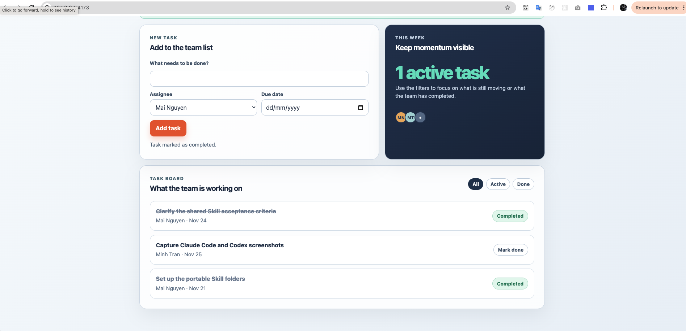
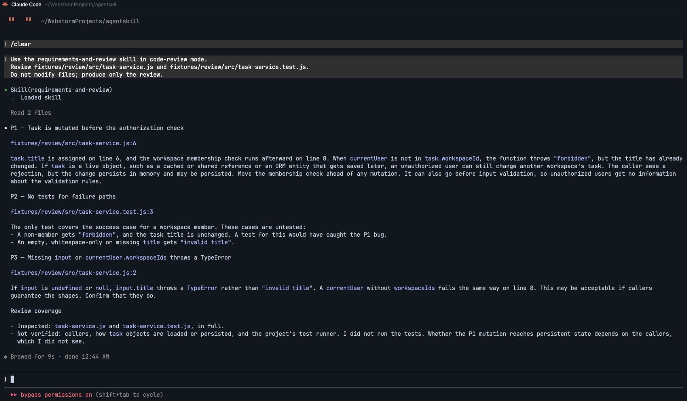
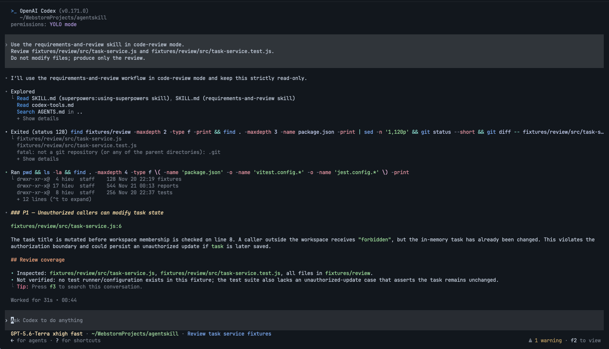
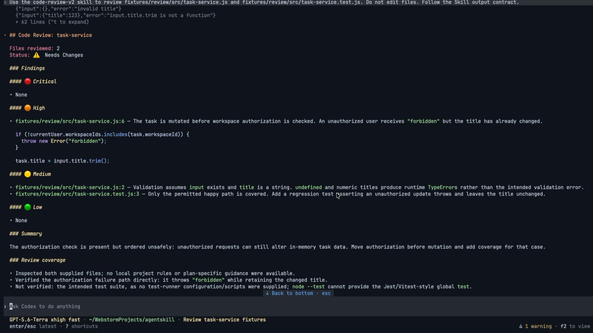

# Một `SKILL.md`, hai coding agent: Agent Skills có thật sự tái sử dụng được không?

Agent Skills đang đi theo một ý tưởng rất thực dụng: thay vì lặp lại prompt
cho những việc quen thuộc, ta đóng gói quy trình thành một thư mục có
`SKILL.md`, kèm tài liệu, script hay asset khi cần. Chuẩn Agent Skills yêu cầu
thư mục Skill có tối thiểu `SKILL.md`, YAML frontmatter và phần hướng dẫn bằng
Markdown; `name` và `description` là hai trường bắt buộc. [Đặc tả chính thức](https://agentskills.io/specification)
cũng khuyến nghị progressive disclosure: agent chỉ đọc metadata ban đầu, rồi
mới nạp hướng dẫn và tài nguyên khi Skill phù hợp.

Điều đáng chú ý là đây không còn là một định dạng độc quyền. Claude Code nói
rõ Skills của họ theo chuẩn mở Agent Skills, dù có thêm các extension riêng như
kiểm soát cách gọi Skill hay dynamic context. [Tài liệu Claude Code](https://code.claude.com/docs/en/skills)
Codex/ChatGPT cũng mô tả Skill là thư mục gồm instructions và resources cho
workflow lặp lại. [Tài liệu OpenAI](https://developers.openai.com/plugins/concepts/skills)
Và đây là một hướng liên nền tảng chứ không chỉ giữa hai hãng: GitHub Copilot
cũng hỗ trợ project skills ở `.github/skills`, `.claude/skills` và
`.agents/skills`. [GitHub Docs](https://docs.github.com/en/copilot/concepts/customizations/agent-skills)

Tôi đã kiểm chứng nhận định đó bằng một Skill thật, không chỉ chuyển đổi
frontmatter trên giấy.

Toàn bộ artifact, source code, fixture, transcript và media của bài có tại
[repository GitHub public](https://github.com/mhieupham1/portable-agent-skills-demo).

## Thí nghiệm: một workflow, hai nhiệm vụ

Artifact gốc là [file `SKILL.md` trên GitHub](https://github.com/mhieupham1/portable-agent-skills-demo/blob/main/agent-skills/requirements-and-review/SKILL.md).
Nó dùng **chỉ** hai trường chuẩn `name` và `description`, không dùng
frontmatter riêng của Claude Code hoặc Codex. Skill có hai mode:

- **Requirement definition**: tách outcome, scope, câu hỏi mở, giả định,
  acceptance criteria, rủi ro và quyết định kế tiếp.
- **Code review**: chỉ nêu lỗi có bằng chứng, bắt buộc priority, file:line,
  failure scenario và review coverage.

*Hình 1 — Portable core của `requirements-and-review`. Cùng workflow được đặt
tại các thư mục Skill của Codex, Claude Code và bản canonical; `SKILL.md` chỉ
dùng frontmatter chuẩn `name` và `description`, rồi định nghĩa hai mode
requirement definition và code review.*

Do vị trí cài đặt mỗi CLI khác nhau, cùng payload được đặt ở
`.claude/skills/requirements-and-review/` cho Claude Code và
`.agents/skills/requirements-and-review/` cho Codex. Ba file có cùng SHA-256:
`f0ec6011fdcd0a160e3420902e0902fd4bcd44b56331e628874ea01251f1648e`.
Nói cách khác, **portable là nội dung Skill; adapter chỉ là đường dẫn cài đặt**.

## Tình huống demo: Shared Todo List

Để thí nghiệm có một bối cảnh sản phẩm nhìn thấy được, repository kèm một web
demo local để các thành viên workspace tạo task, giao cho một người, đánh dấu
hoàn thành và lọc `All / Active / Done`. Đây là tương tác chạy thật trong trình
duyệt, nhưng **không** có backend, login, persistence hay dữ liệu thật; giao
diện tự ghi rõ đó là local demo.

Mã nguồn web demo có tại [GitHub](https://github.com/mhieupham1/portable-agent-skills-demo/tree/main/demo/shared-todo):

- [`index.html` trên GitHub](https://github.com/mhieupham1/portable-agent-skills-demo/blob/main/demo/shared-todo/index.html): cấu trúc trang và accessibility contract.
- [`app.js` trên GitHub](https://github.com/mhieupham1/portable-agent-skills-demo/blob/main/demo/shared-todo/app.js): điều khiển form, filter và thao tác hoàn thành task.
- [`task-list.mjs` trên GitHub](https://github.com/mhieupham1/portable-agent-skills-demo/blob/main/demo/shared-todo/task-list.mjs): lifecycle task và filter thuần.
- [Tests trên GitHub](https://github.com/mhieupham1/portable-agent-skills-demo/tree/main/demo/shared-todo/tests): kiểm thử lifecycle cùng page contract.

Web này là **artifact minh họa**, không phải bằng chứng một model giỏi hơn hay
thay cho evaluation. Nó cho người đọc cùng ngữ cảnh sản phẩm với hai procedure
được kiểm tra ở dưới.

*Hình 2 — Shared Todo List chạy local. Ảnh cho thấy form tạo task, bộ lọc
`All / Active / Done`, task đã hoàn thành và số lượng task còn active.*

Tôi dùng cùng prompt tương ứng, cùng fixture và rubric cho cả hai agent. Bài
requirement dùng [fixture Shared Todo List trên GitHub](https://github.com/mhieupham1/portable-agent-skills-demo/blob/main/fixtures/requirements-request.md)
trong cùng bối cảnh Shared Todo List: thành viên workspace tạo task, giao task
và đánh dấu hoàn thành. Quyền sửa/xóa task của người khác, deadline/timezone,
recurring task, retention/reopen, thông báo và concurrent edit đều cố ý để
trống. Bài code review dùng fixture authorization độc lập, có lỗi rõ ràng: code
đổi title task trước khi kiểm tra người gọi có thuộc workspace hay không. Việc
tách fixture nhỏ khỏi web UI giúp rubric đo được đúng một failure scenario,
thay vì lẫn với chất lượng thiết kế giao diện.

*Hình 3 — Fixture Shared Todo List được mở trong IDE. Yêu cầu chỉ nêu outcome
cơ bản; quyền sửa/xóa, deadline/timezone, retention, notification và concurrent
edit vẫn cố ý để trống.*

Rubric không đòi văn phong giống nhau. Nó chỉ hỏi những thứ quan sát được: brief
có scope/câu hỏi/assumption/acceptance criteria không; review có nhận ra lỗi,
priority, `file:line` và phạm vi đã kiểm tra không. Toàn bộ fixture, rubric và
transcript có trong [báo cáo kiểm thử](https://github.com/mhieupham1/portable-agent-skills-demo/blob/main/reports/eval-2026-11-21-shared-todo/RESULTS.md).

### Demo requirement definition trên hai CLI

Cả Claude Code lẫn Codex nhận cùng prompt, đọc cùng
`fixtures/requirements-request.md` và không được phép sửa file. Mục tiêu ở đây
không phải để hai câu trả lời giống chữ nhau, mà để kiểm tra cả hai có thực hiện
cùng output contract của Skill hay không.

#### Claude Code

*Hình 4a — Claude Code nạp `requirements-and-review`, đọc fixture và tạo brief
Shared Todo List theo output contract. [Xem toàn bộ kết quả trong video](https://raw.githubusercontent.com/mhieupham1/portable-agent-skills-demo/main/assets/article/04a-claude-requirements.mp4),
vì output cần cuộn mới xem hết.*

#### Codex

*Hình 4b — Codex nhận cùng prompt, đọc `requirements-and-review` và tạo brief
cho Shared Todo List. [Xem toàn bộ kết quả trong video](https://raw.githubusercontent.com/mhieupham1/portable-agent-skills-demo/main/assets/article/04b-codex-requirements.mp4),
bao gồm các phần `Outcome`, `Open questions`, `Assumptions` và
`Acceptance criteria` khi output được cuộn.*

### Demo code review trên hai CLI

Tác vụ thứ hai dùng cùng hai file `task-service.js` và `task-service.test.js`.
Fixture cố ý thay title task trước khi kiểm tra workspace membership; vì vậy một
review đạt yêu cầu phải nêu được mutation trước authorization, vị trí dòng,
priority và phạm vi đã kiểm tra.

#### Claude Code

*Hình 5a — Claude Code nạp `requirements-and-review`, báo `P1` về mutation
trước authorization ở `task-service.js:6`, rồi liệt kê các failure path chưa có
test và review coverage.*

#### Codex

*Hình 5b — Codex báo `P1` tại `task-service.js:6`: task bị đổi trước khi kiểm
tra workspace membership, nên request bị từ chối vẫn có thể để lại thay đổi
trong object. Output cũng công bố review coverage và testing gap.*

## Demo thứ hai: một Skill review có cấu trúc

Skill đầu tiên chỉ có 64 dòng nên phù hợp để kiểm tra portable core, nhưng chưa
đủ để minh họa một workflow review đầy đủ hơn. Vì thế repository có thêm
[source `code-review-v2` trên GitHub](https://github.com/mhieupham1/portable-agent-skills-demo/tree/main/agent-skills/code-review-v2): một Skill gồm
167 dòng hướng dẫn và hai reference đi kèm.

Gói này cho thấy một Skill không chỉ là một prompt ngắn. Nó làm ba việc:

- `SKILL.md` định nghĩa lúc nào bắt đầu review, checklist về correctness,
  security, types và performance, cách phân severity, cùng format báo cáo.
- `references/verification-gates.md` buộc agent có bằng chứng trước khi kết
  luận và ghi rõ điều gì chưa kiểm chứng.
- `references/receiving-feedback.md` hướng dẫn tiếp nhận phản hồi kỹ thuật
  bằng cách xác minh, thay vì đồng ý cho có.

Cùng gói đó được cài nguyên byte vào `.claude/skills/` và `.agents/skills/`.
Các giả định chỉ phù hợp với một repository đã được tổng quát hóa: agent chỉ
đọc `AGENTS.md`, `CLAUDE.md` hoặc `docs/code-standards.md` nếu chúng tồn tại;
ưu tiên file/diff người dùng chỉ định; và luôn công bố review coverage.

Trong fixture authorization-order bug, hai lần chạy ghi lại đều đạt **6/6**
theo rubric: review envelope, severity structure, file/line, nhận ra mutation
trước workspace authorization, impact và scope disclosure. [Báo cáo port/eval](https://github.com/mhieupham1/portable-agent-skills-demo/blob/main/reports/code-review-v2-eval-2026-11-21-shared-todo/RESULTS.md)
cung cấp transcript, rubric và cách chạy lại.

### Demo `code-review-v2` trên Claude Code và Codex

Lần này cả hai CLI nhận cùng prompt review và cùng fixture, nhưng output
contract đòi thêm severity structure, `Summary` và `Review coverage`.

#### Claude Code

*Hình 6a — Claude Code nạp `code-review-v2`, đặt status Blocked, phân severity
và đề xuất đưa authorization lên trước mutation. [Xem toàn bộ kết quả trong video](https://raw.githubusercontent.com/mhieupham1/portable-agent-skills-demo/main/assets/article/06a-claude-code-review-v2.mp4),
vì phần review dài cần cuộn.*

#### Codex

*Hình 6b — Codex chạy `code-review-v2` với cấu trúc severity Critical/High/
Medium/Low, finding ở `task-service.js:6`, `Summary` và `Review coverage`.
[Xem toàn bộ kết quả trong video](https://raw.githubusercontent.com/mhieupham1/portable-agent-skills-demo/main/assets/article/06b-codex-code-review-v2.mp4),
vì phần review dài cần cuộn.*

Đây là một lượt chạy có gọi Skill tường minh trên mỗi CLI, nên không phải bằng
chứng Skill “làm model thông minh hơn”. Nó chỉ cho thấy khi Skill được gọi, cả
hai platform đã thực thi cùng output contract trên case nhỏ này.

### Môi trường chạy

Lượt chạy được ghi nhận lúc **2026-11-20T17:13:31Z** (ngày **2026-11-21** tại
Việt Nam); để kết quả có thể đối chiếu, hai platform dùng model và CLI sau:

| Platform | CLI | Model |
| --- | --- | --- |
| Claude Code | 2.1.329 | `claude-sonnet-5-5` |
| Codex | 0.171.0 | `gpt-5.6-terra` |

Mỗi platform nhận cùng prompt, cùng fixture và chạy ở chế độ chỉ đọc. Đây không
phải phép so sánh năng lực tuyệt đối giữa hai model: chỉ một lần chạy mỗi tác vụ
không đủ để kết luận về độ ổn định, chi phí hay độ chính xác trên codebase thật.

## Kết quả cho portable core: procedure tái dùng được; kết quả không tự động đồng nhất

| Nền tảng | Requirement definition | Code review | Kết quả |
| --- | ---: | ---: | --- |
| Codex CLI 0.171.0 | 4/4 | 4/4 | Pass, tổng 8/8 |
| Claude Code 2.1.329 | 4/4 | 4/4 | Pass, tổng 8/8 |

Ở Codex, agent đã thực sự đọc `SKILL.md`, tạo brief với các heading được yêu
cầu, hỏi đúng các quyết định material như quyền sửa/xóa, deadline, retention,
notification và concurrent edit. Ở bài review, nó báo `P1` tại
`task-service.js:6`: user ngoài workspace vẫn làm đổi object trước khi code ném
`forbidden`. Đây là chính xác failure scenario mà fixture được thiết kế để kiểm
tra.

Với Claude Code, agent tạo đủ brief yêu cầu và tìm đúng lỗi mutation trước
workspace authorization tại dòng 6; nó còn chỉ ra các điểm validation và test
coverage chưa có.

Kết luận chính xác là: **cùng một artifact và procedure đã chạy thành công trên
cả Claude Code lẫn Codex trong hai tác vụ đã kiểm tra.** Nhưng đây vẫn là smoke
evaluation một lần mỗi tác vụ, không phải chứng minh rằng hai model luôn có chất
lượng, tốc độ hay tool behavior giống nhau.

## Tôi nghĩ gì về chuẩn hóa Agent Skills?

Tôi ủng hộ chuẩn hóa phần nhỏ và bền: cấu trúc thư mục, frontmatter tối thiểu,
tài nguyên đi kèm và progressive disclosure. Đây là “lớp giao thức” đủ đơn giản
để di chuyển quy trình giữa công cụ mà không buộc mọi nhà cung cấp phải chia sẻ
cùng UX hay tool API. Việc Anthropic chuyển giao Agent Skills cho Agentic AI
Foundation là một tín hiệu tích cực cho hướng vendor-neutral này. [Thông báo của Anthropic](https://www.anthropic.com/news/donating-agent-skills-to-the-agentic-ai-foundation)

Tuy nhiên, chuẩn càng cố mô tả execution policy càng dễ trở nên mong manh. Ví
dụ, `disable-model-invocation`, dynamic context hay cấu hình subagent là extension
hữu ích của một platform, nhưng không nên nằm trong “portable core”. Một Skill
dùng chung nên giữ body trung lập: outcome, bằng chứng cần xem, điều kiện dừng
và format đầu ra. Những gì phụ thuộc CLI, quyền truy cập, hook hoặc model nên
được đặt trong adapter của từng nền tảng hoặc tài liệu triển khai riêng.

Nói ngắn gọn: standardization nên làm cho **quy trình** di chuyển được, không
hứa hẹn rằng **chất lượng quyết định** của các agent sẽ bằng nhau.

## Tôi sẽ dùng nó thế nào trong công việc hằng ngày?

Tôi sẽ bắt đầu với những công việc lặp lại, đắt vì dễ quên bước hơn là đắt vì
thiếu kiến thức: triage bug, chuẩn bị requirement trước khi code, code review,
release checklist, viết changelog và kiểm tra tài liệu sau thay đổi API.

Với requirement, Skill buộc tôi và agent làm rõ phần nào là fact, phần nào là
assumption, rồi biến mong muốn mơ hồ thành acceptance criteria có thể test. Điều
này giảm vòng “xong rồi mới phát hiện product chưa quyết quyền/retention”. Với
review, format priority + `file:line` + failure scenario tránh review kiểu “có
vẻ không ổn”; tác giả có thể tái hiện và quyết định sửa nhanh hơn.

Quy trình thực tế của tôi sẽ là: lưu portable core cùng repository, cài cùng
payload vào thư mục native của agent đang dùng, và có một fixture/rubric nhỏ
như bài này trước mỗi thay đổi lớn của Skill. Tôi sẽ version Skill như code,
đo pass rate và false positive theo từng workflow. Khi chuyển từ Codex sang
Claude Code hoặc Copilot, tôi mang theo procedure, acceptance contract và eval;
tôi không mang theo giả định rằng một agent khác sẽ cho đúng cùng câu trả lời.

Đó mới là lợi ích bền vững nhất của Agent Skills: biến kinh nghiệm vận hành tốt
thành tài sản kiểm thử được, thay vì một đoạn prompt sống trong lịch sử chat của
một người.
